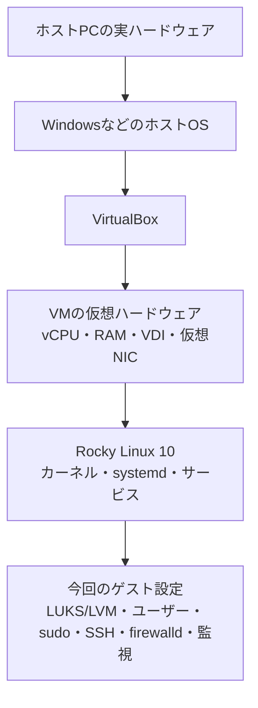

# Rocky Linux 10（Born2beRoot）構築・検証手順書

この手順書は、Rocky Linux 10をVirtualBoxにインストールし、課題要件を設定・検証し、評価中に設定変更を求められた場合に対応するためのものです。ここでは作業用ユーザーを例として `shirano42`、ログイン名を `shirano42`、ホスト名を `shirano42` とします。実際の課題PDF/READMEに書かれた値が異なる場合は、そちらを優先してください。

> **安全の基本**: 設定変更前にVirtualBoxのスナップショットを作り、変更後は検証コマンドを実行します。SSH・sudo・PAM設定の作業中は、VirtualBoxのコンソールからrootまたはsudo可能なユーザーでログインできる状態を維持します。暗号化パスフレーズ、ユーザーパスワード、秘密情報をスクリーンショットや提出物に含めないでください。

コマンド例の先頭にある`sudo`は、sudo設定済みの一般ユーザーで実行する印です。rootでログインしている場合は`sudo`を外して実行してください。sudo自体が未導入・未設定なら、先にrootコンソールからsudoを導入・設定します。

## 0. 要件チェックリスト

| 項目 | 実装 | 確認方法 | 状態の目安 |
|---|---|---|---|
| Rocky Linux 10、CUI、ホスト名 | OSを更新し、指定されたログイン名に合わせたホスト名 | `cat /etc/rocky-release`, `hostnamectl` | Rocky 10、GUIなし、名前が要件どおり |
| 暗号化LVM | インストーラーでLVM内の対象ボリュームを暗号化 | `lsblk -f`, `pvs`, `vgs`, `lvs` | LUKSデバイスの内側にLVM/XFS等が見える |
| SELinux | Enforcingで起動 | `getenforce`, `sestatus` | `Enforcing` |
| ユーザー・グループ | 通常ユーザー、`user42`、sudo管理グループ | `id shirano42`, `getent group user42` | 対象ユーザーが必要な全グループに所属 |
| sudo | 3回制限、独自メッセージ、TTY、入出力ログ、secure_path | `visudo -c`, `sudo -l`, ログ確認 | 構文OK、設定値とログが存在 |
| パスワード | 期限、複雑さ、履歴 | `chage -l USER`, `pwquality.conf`, authselect | PDF記載値と一致 |
| SSH | TCP 4242、root SSH禁止 | `sshd -T`, `ss -lntp` | `port 4242`, `permitrootlogin no`, LISTEN |
| firewalld | 起動時有効、必要ポートのみ許可 | `systemctl`, `firewall-cmd` | 4242/tcpが許可され不要な受信サービスがない |
| monitoring.sh | 起動時と10分ごとに実行し、`wall`で表示 | `bash -n`, `sudo crontab -l`, cronログ | スクリプト正常、cron登録あり |
| 提出物 | README、比較説明、VDIのSHA-1等 | 提出物とPDFを照合 | 必須ファイルが揃い、仮想ディスク本体を誤提出していない |

## 1. root・一般ユーザー・スナップショット

### 1.1 rootとユーザーの切り替え

- rootから通常ユーザーへ: `su - shirano42`
- 通常ユーザーからrootシェルへ: `sudo -i`（または `su -`。後者はrootパスワードが必要）
- `su -` / `sudo -i`で入ったrootシェルから戻る: `exit`
- 変更前に今のユーザーを確認: `whoami`; グループは `id`

プロンプトが `#` でも、それだけで判断せず `whoami` を使います。最小構成で `whoami` が見つからない特殊なシェルに入った場合は、通常のログイン画面まで戻り、Rockyが正常起動しているか確認してください。緊急モードやinitramfsでは通常の設定作業を続けません。

### 1.2 VirtualBoxスナップショット

VMを起動した状態でも、VirtualBoxのメニューから「スナップショット」を作成できます。わかる名前（例: `ssh-firewall設定前`）と説明を付けます。構築中の復旧用に使い、Born2beRootの評価開始時にはスナップショットを削除しておきます（評価ルール上、評価中のテスト用スナップショットは許可されても、開始時は残さない指定です）。スナップショットはバックアップの代わりではありません。

## 2. OSと基本状態の確認

```bash
cat /etc/rocky-release
uname -r
hostnamectl
whoami
id
```

Rocky 10であることを確認します。Minimalインストールでネットワーク・DNSが使えることを確認してから更新します。

```bash
ip -4 addr
ip route
getent hosts rockylinux.org
sudo dnf update -y
```

`getent`が名前解決できない場合は、VMのネットワークアダプター設定とDNSを先に直します。通常のSSHやFirewall作業は、VirtualBoxコンソールからのログインを確保してから始めます。

SELinuxとfirewalldを確認します。

```bash
getenforce
sestatus
systemctl is-enabled firewalld
systemctl is-active firewalld
```

SELinuxが`Disabled`または`Permissive`なら、課題要件に従ってEnforcingに戻し、再起動後もEnforcingであることを確認します。`/etc/selinux/config`を変更する場合は、変更前にバックアップを取り、`SELINUX=enforcing`にして再起動します。無効化で問題を回避しないでください。

## 3. 暗号化LVMの確認

```bash
lsblk -o NAME,TYPE,FSTYPE,SIZE,MOUNTPOINTS
lsblk -f
sudo pvs
sudo vgs
sudo lvs -a -o +devices
findmnt
swapon --show
```

これまでのVMでは概ね `/boot` が通常のXFS、LVM物理ボリュームがLUKSで暗号化され、その内側にroot/home/swapの論理ボリュームがありました。表示名やデバイス名はインストールごとに異なるので、`sda3`やUUIDを決め打ちしません。起動時に暗号化パスフレーズを受け付けてOSが正常起動し、`lsblk -f`で`crypto_LUKS`の下にLVMとファイルシステムが見えることを確認します。

暗号化構成が違う場合、稼働中のシステムでパーティションを作り直すコマンドを実行しないでください。評価要件に適合しなければ、インストーラーで構成を直すか、再インストールを検討します。特にLUKS UUID、`/etc/crypttab`、initramfsの不整合は起動不能の原因になります。

## 4. ホスト名、ユーザー、グループ

### 4.1 ホスト名

初期設定:

```bash
sudo hostnamectl set-hostname shirano42
hostnamectl
hostname
```

ホスト名にログイン名を使う要件なら、指定された文字列と一致させます。評価中に変更を求められた場合の手順は「10. 評価中の追加・変更」を参照してください。

### 4.2 ユーザーとグループ

既存状態を先に確認します。

```bash
getent passwd shirano42
getent group user42
getent group sudo
getent group wheel
id shirano42
```

未作成なら、rootで例のユーザーとグループを作ります。既に存在するものを重ねて作成しないでください。

```bash
sudo groupadd user42
sudo groupadd sudo
sudo useradd -m -s /bin/bash shirano42
sudo passwd shirano42
sudo usermod -aG user42,sudo,wheel shirano42
```

`groupadd`が「既に存在」と言う場合は、`getent group`で存在を確認して次へ進みます。`usermod -aG`の`-a`を落とすと既存の補助グループを外すため、必ず`-aG`とします。Rockyの標準管理グループは`wheel`です。課題が`sudo`というグループへの所属も求める場合は、`sudo`グループとsudoersルールを別途用意します。

確認:

```bash
id shirano42
getent group user42
getent group sudo
```

グループ追加後は一度ログアウトして再ログインし、グループ情報を更新します。

## 5. sudoの設定とログ

必要ならインストールします。

```bash
sudo dnf install -y sudo
sudo install -d -o root -g root -m 0700 /var/log/sudo
```

sudoグループを課題で使う場合は、専用ファイルを`visudo`で作ります。

```bash
sudo visudo -f /etc/sudoers.d/10-sudo-group
```

ファイルの内容:

```sudoers
%sudo ALL=(ALL:ALL) ALL
```

Rocky標準の`wheel`を管理グループとして使う要件なら、`wheel`の既定ルールを確認して使います。重複ルールをむやみに追加しません。

課題用ポリシーを作成:

```bash
sudo visudo -f /etc/sudoers.d/20-sudo-policy
```

内容（secure_pathはRockyで通常使うコマンド検索パス。READMEに指定値がある場合はそちらを優先）:

```sudoers
Defaults passwd_tries=3
Defaults badpass_message="Authentication failed; try again."
Defaults use_pty
Defaults log_input
Defaults log_output
Defaults iolog_dir="/var/log/sudo"
Defaults logfile="/var/log/sudo/sudo.log"
Defaults secure_path="/usr/local/sbin:/usr/local/bin:/usr/sbin:/usr/bin:/sbin:/bin"
```

保存時にファイル名の末尾が`.tmp`になっていないか確認します。`visudo`で編集し、許可モードを設定・検証します。

```bash
sudo chown root:root /etc/sudoers.d/10-sudo-group /etc/sudoers.d/20-sudo-policy
sudo chmod 0440 /etc/sudoers.d/10-sudo-group /etc/sudoers.d/20-sudo-policy
sudo visudo -c
sudo -l
sudo ls -la /var/log/sudo
sudo tail -n 10 /var/log/sudo/sudo.log
```

`visudo -c`が全ファイルで`parsed OK`になることが必要です。`logfile`はsudoコマンドの記録、`iolog_dir`はTTY入出力記録の保存先です。ログファイルがまだなければ、sudoコマンドを一度実行してから確認します。ログにパスワードそのものが保存されるわけではありませんが、入出力記録に機密情報を入力しないよう注意します。

## 6. パスワード期限・複雑さ・履歴

### 6.1 期限

課題で指定された通常ユーザーとrootに設定します（例: 最大30日、最短2日、期限警告7日）。

```bash
sudo chage -m 2 -M 30 -W 7 shirano42
sudo chage -m 2 -M 30 -W 7 root
sudo chage -l shirano42
sudo chage -l root
```

`Password expires`が`never`のままなら設定できていません。`Last password change`、期限、最小・最大日数、警告日数を各アカウントで確認します。設定後にパスワードを更新すると期限の起点が明確になります。

### 6.2 パスワード複雑さ

RockyではPAMの手書き編集を避け、まず現在のauthselectプロファイルを確認します。

```bash
authselect current
sudo cp -a /etc/security/pwquality.conf /etc/security/pwquality.conf.bak
sudo vi /etc/security/pwquality.conf
```

課題で必要な値の例:

```ini
difok = 7
minlen = 10
dcredit = -1
ucredit = -1
lcredit = -1
maxrepeat = 3
usercheck = 1
enforce_for_root
```

意味: 10文字以上、数字・大文字・小文字を少なくとも1文字、ユーザー名を含めない、同じ文字の連続は最大3文字、前のパスワードと少なくとも7文字異なることを要求します。`difok`は通常ユーザーのパスワード変更で旧パスワードを比較します。rootのように旧パスワードを尋ねない変更では同じ比較にならないため、rootにも複雑さが適用されているか別に確認します。課題PDFの具体値が異なる場合は上記を置き換えます。

Rockyのパスワード変更がpwqualityを使うか確認するには、次を実行します。

```bash
grep -n 'pam_pwquality' /etc/pam.d/system-auth /etc/pam.d/password-auth
```

設定ファイルへの記述だけでは有効化を証明できません。authselect管理のPAMファイルを直接編集せず、実際に課題要件どおりの弱いパスワードが拒否され、要件を満たす新しいパスワードが受理されることで確認します。テスト時は既存パスワードを忘れないようにし、コンソールを維持します。

### 6.3 パスワード履歴（要件に指定がある場合）

履歴数は課題資料で指定された値を使います。資料に数値がなければ勝手に「5回」と断定せず、要件を確認してください。Rockyのauthselectを使う場合は、利用可能機能と現在のプロファイルを確認してから機能を有効にします。

```bash
authselect current
authselect list-features
```

`with-pwhistory`が利用でき、現在のプロファイルに対して適用可能なことを確認した場合の例:

```bash
sudo cp -a /etc/security/pwhistory.conf /etc/security/pwhistory.conf.bak
sudo vi /etc/security/pwhistory.conf
```

ファイルに要件値を記載します（例の`remember = 5`はPDFが5回を求める場合だけ使う）。rootにも履歴を強制する要件なら`enforce_for_root`も設定します。その後:

```bash
sudo authselect enable-feature with-pwhistory
sudo authselect apply-changes
authselect current
grep -n 'pam_pwhistory' /etc/pam.d/system-auth /etc/pam.d/password-auth
```

プロファイルや機能が異なる場合はそこで止め、`authselect`のバックアップや表示内容を確認します。PAMファイルを直接書き換えるとログイン・パスワード変更ができなくなる危険があります。履歴機能を有効化した後に変更したパスワードから履歴が蓄積されます。

## 7. SSHを4242番に設定しrootログイン禁止

### 7.1 設定

```bash
sudo dnf install -y openssh-server policycoreutils-python-utils
sudo install -d -m 0755 /etc/ssh/sshd_config.d
sudo vi /etc/ssh/sshd_config.d/00-born2beroot.conf
```

内容:

```sshconfig
Port 4242
PermitRootLogin no
```

先行して読み込ませるため`00-`という名前を使います。Rockyの`Include /etc/ssh/sshd_config.d/*.conf`を確認します。設定ファイルを保存したら、**再起動前に**構文と実効値を確認します。

```bash
sudo sshd -t
sudo sshd -T | grep -E '^(port|permitrootlogin) '
```

期待値は`port 4242`と`permitrootlogin no`です。`sshd -T`の値が違うときは、`grep -RniE '^[[:space:]]*(Port|PermitRootLogin)' /etc/ssh/sshd_config /etc/ssh/sshd_config.d`で重複設定を調べます。Rockyでは先に読み込んだ設定値が優先されることがあります。

### 7.2 SELinuxとFirewall

SELinuxでSSH用ポートとしてTCP 4242を登録します。

```bash
sudo semanage port -l | grep '^ssh_port_t'
```

4242がまだ登録されていない場合:

```bash
sudo semanage port -a -t ssh_port_t -p tcp 4242
```

すでに別のSELinuxタイプで登録されているときは、結果を確認してから`-m`で変更します。意味を確認せず既存定義を上書きしません。

firewalldの実行中ゾーンを確認:

```bash
sudo firewall-cmd --get-active-zones
sudo firewall-cmd --zone=public --list-all
```

実行時ではなく、再起動後も残す永続設定に4242/tcpを追加します。`--permanent`がない設定は`--reload`で永続設定を読み込み直すと消えることがあります。インターフェースが別ゾーンなら`public`をそのゾーン名に読み替えます。

```bash
sudo firewall-cmd --permanent --zone=public --add-port=4242/tcp
sudo firewall-cmd --permanent --zone=public --remove-service=ssh
sudo firewall-cmd --reload
sudo firewall-cmd --zone=public --list-all
sudo firewall-cmd --permanent --zone=public --list-all
```

`--remove-service=ssh`が「NOT_ENABLED」でも、SSHサービスがもともと許可されていない意味なので問題ありません。課題が「受信は4242だけ」を求める場合は、一覧に不要なサービス・ポートがないか確認します。DHCPv6クライアント等を削除するかは、課題の「only」をどう定義しているかとVMネットワーク要件に従います。

#### PDFの例のように`ssh`と`4242/tcp`を両方表示する場合

`--list-services`はサービス名、`--list-ports`はポート番号で登録したルールを別々に表示します。PDFのRocky例は両方の一覧に出ています。標準の`ssh`サービスは通常22/tcpを許可するため、標準定義のまま両方を有効にすると22番もFirewallで許可されます。課題文の「4242番だけ」と食い違わないか注意します。

両方を表示しながら許可ポートを4242だけにするには、ローカルの`ssh`サービス定義を4242番にしたうえで、同じ4242/tcpをポート指定でも登録します。これはサービス定義の上書きであり、通常のRocky設定ではありません。既に`/etc/firewalld/services/ssh.xml`を作成した場合に限り、内容を確認します。

```bash
cat /etc/firewalld/services/ssh.xml
firewall-cmd --check-config
firewall-cmd --info-service=ssh
```

`--info-service=ssh`が4242/tcpを示し、22/tcpを示さないことを確かめてから、永続設定にポートルールを追加します。

```bash
firewall-cmd --permanent --zone=public --add-service=ssh
firewall-cmd --permanent --zone=public --add-port=4242/tcp
firewall-cmd --reload
firewall-cmd --zone=public --list-services
firewall-cmd --zone=public --list-ports
firewall-cmd --zone=public --list-all
```

`ssh`と`4242/tcp`が表示され、`--info-service=ssh`が4242/tcpを指していれば、同じ4242番をサービス名・ポート名の両方で表しています。`--info-service=ssh`が22/tcpならこの方法をそのまま使わず、PDFの例が課題の「4242番だけ」という要件と矛盾していないか確認します。

設定の区別:

- `--add-port=4242/tcp`（`--permanent`なし）: 実行中だけの一時設定
- `--permanent --add-port=4242/tcp`: 永続設定。再起動後も残る
- `--reload`: 永続設定を実行中の設定へ読み込み直す。一時設定だけの変更は消える

従って、再起動後にも維持するなら`--permanent`で追加し、`--reload`後に`--permanent --list-all`でも確認します。

### 7.3 起動・検証

```bash
sudo systemctl enable --now sshd
sudo systemctl restart sshd
systemctl is-enabled sshd
systemctl is-active sshd
sudo ss -lntp | grep ':4242'
sudo journalctl -u sshd -n 30 --no-pager
```

`sshd`再起動に失敗したら、繰り返し再起動せず`journalctl`を確認します。`Bind to port 4242 ... Permission denied`はSELinuxのポートタイプ、`Address already in use`は別プロセスの待受、構文エラーは`sshd -t`の出力を確認します。

別端末から接続できる環境なら`ssh -p 4242 shirano42@VMのIPアドレス`で試験します。VirtualBoxのNATではホストから到達するにはポートフォワーディング設定が必要です。SSH接続試験のためにrootログインを許可しないでください。

## 8. firewalldの起動時有効化

```bash
sudo systemctl enable --now firewalld
systemctl is-enabled firewalld
systemctl is-active firewalld
sudo firewall-cmd --get-active-zones
sudo firewall-cmd --zone=public --list-all
sudo firewall-cmd --permanent --zone=public --list-all
```

実行時設定と`--permanent`設定の両方を見ます。`--reload`後に設定が反映されていること、SSHの4242/tcpが残っていることを確認します。作業中に自分のSSH接続を切断する変更は、VMコンソールを確保した後に行います。

## 9. monitoring.shとcron

### 9.1 スクリプト

課題指定の出力項目が最優先です。以下は今回のVMで確認した項目を表示するRocky向けのひな型です。項目や形式がREADMEと違うときはREADMEに合わせて調整してください。

```bash
sudo vi /usr/local/bin/monitoring.sh
```

```bash
#!/usr/bin/env bash
set -u

physical_cpus=$(lscpu | awk -F: '$1 ~ /Socket/ {gsub(/[[:space:]]/, "", $2); print $2; exit}')
virtual_cpus=$(nproc)
mem_total=$(awk '/MemTotal/ {printf "%.0f", $2/1024}' /proc/meminfo)
mem_used=$(awk '/MemTotal/ {t=$2} /MemAvailable/ {a=$2} END {printf "%.0f", (t-a)/1024}' /proc/meminfo)
mem_available=$(awk '/MemAvailable/ {printf "%.0f", $2/1024}' /proc/meminfo)
mem_percent=$(awk -v u="$mem_used" -v t="$mem_total" 'BEGIN {if (t>0) printf "%.2f", 100*u/t; else print "0.00"}')
disk_usage=$(df -hP / | awk 'NR==2 {print $3 " / " $2 " (" $5 " used)"}')
read_cpu_counters() { awk '/^cpu / {idle=$5+$6; total=0; for (i=2;i<=NF;i++) total+=$i; print total, idle; exit}' /proc/stat; }
read -r cpu_total_1 cpu_idle_1 < <(read_cpu_counters)
sleep 1
read -r cpu_total_2 cpu_idle_2 < <(read_cpu_counters)
cpu_load=$(awk -v t1="$cpu_total_1" -v i1="$cpu_idle_1" -v t2="$cpu_total_2" -v i2="$cpu_idle_2" 'BEGIN {dt=t2-t1; di=i2-i1; if (dt>0) printf "%.1f", 100*(dt-di)/dt; else print "0.0"}')
last_boot=$(who -b | sed 's/^.*system boot[[:space:]]*//')
lvm_status=$(if command -v lvs >/dev/null 2>&1 && lvs --noheadings >/dev/null 2>&1; then echo yes; else echo no; fi)
tcp_connections=$(ss -Htn state established | wc -l)
logged_users=$(who | wc -l)
interface=$(ip -4 -o route show default 2>/dev/null | awk 'NR==1 {print $5}')
if [[ -n "$interface" ]]; then
  ip_address=$(ip -4 -o addr show dev "$interface" scope global 2>/dev/null | awk 'NR==1 {split($4,a,"/"); print a[1]}')
  mac_address=$(cat "/sys/class/net/$interface/address" 2>/dev/null || echo unknown)
else
  ip_address=unknown
  mac_address=unknown
fi
sudo_commands=$(grep -c 'COMMAND=' /var/log/sudo/sudo.log 2>/dev/null || true)

wall <<EOF
#Architecture: $(uname -m)
#Kernel: $(uname -r)
#Physical CPU: ${physical_cpus:-unknown}
#vCPU: ${virtual_cpus:-unknown}
#Memory Usage: ${mem_used}/${mem_total}MB (${mem_percent}% used; ${mem_available}MB available)
#Disk Usage: ${disk_usage:-unknown}
#CPU load: ${cpu_load}%
#Last boot: ${last_boot:-unknown}
#LVM use: ${lvm_status}
#TCP Connections: ${tcp_connections} ESTABLISHED
#User log: ${logged_users}
#Network: IP ${ip_address} (${mac_address})
#Sudo: ${sudo_commands} cmd
EOF
```

`wall`はログイン中の端末にブロードキャストします。複数の端末/TTYがログイン中ならそれぞれに表示されます。手動で`sudo /usr/local/bin/monitoring.sh`を実行した場合、`wall`のブロードキャストに加え、sudoのTTY入出力記録が手元に流れて同じ内容が2回見えることがあります。これはcronが2つ登録された証拠ではありません。

権限と構文を確認します。

```bash
sudo chown root:root /usr/local/bin/monitoring.sh
sudo chmod 0755 /usr/local/bin/monitoring.sh
sudo bash -n /usr/local/bin/monitoring.sh
sudo /usr/local/bin/monitoring.sh
```

`bash -n`が無出力なら構文エラーはありません。手動実行ではメッセージが画面に出るのが正常です。`wall: command not found`なら`sudo dnf install -y util-linux`の後に再確認します。

### 9.2 cron登録

rootのcrontabを編集します。

```bash
sudo crontab -e
```

次のように登録します。PATH行を入れると、cronの最小環境でもコマンドを見つけやすくなります。

```cron
PATH=/usr/local/sbin:/usr/local/bin:/usr/sbin:/usr/bin:/sbin:/bin
@reboot /usr/local/bin/monitoring.sh
*/10 * * * * /usr/local/bin/monitoring.sh
```

一時的に毎分実行して試験する場合は、10分ごとの行を`* * * * * /usr/local/bin/monitoring.sh`に**置き換えます**。元の10分ごとの行を残したまま毎分行を追加すると、毎時0,10,20,30,40,50分に2回実行されます。試験後は毎分行を削除して、10分ごとの1行だけに戻します。

確認:

```bash
sudo crontab -l
systemctl is-enabled crond
systemctl is-active crond
sudo journalctl -u crond --since today --no-pager
```

「毎時0,10,20,30,40,50分」に一回実行されます。VMの時計と次の10分境界を確認して、ログイン端末に一度表示されるか待ちます。起動時ジョブは、ログイン前に実行されることがあり、その場合`wall`を受け取る端末がまだないため、画面に見えなくてもcron登録・実行失敗とは限りません。課題が起動時表示を要求するなら、起動時点で受信端末が存在する条件も評価方法に合わせて確認してください。

#### 同じ定期通知が同時刻に二重表示されるとき

同じ内容・同じ秒の通知が2回出るなら、まず`monitoring.sh`が同時刻に二度起動したのか、`wall`の送信先TTYが複数あるのかを切り分けます。特に試験中の毎分行と通常の10分行を両方残した場合、10分境界では2回起動します。rootと一般ユーザーのcrontabに同じジョブがある場合や、`/etc/cron.d`にも登録した場合も重複します。

```bash
sudo crontab -l
sudo -u shirano42 crontab -l
sudo grep -RnsF '/usr/local/bin/monitoring.sh' /etc/crontab /etc/cron.d 2>/dev/null
sudo journalctl -u crond --since '30 minutes ago' --no-pager
who -a
sudo grep -nE 'wall|monitoring\.sh' /usr/local/bin/monitoring.sh
loginctl list-sessions
sudo grep 'monitoring.sh' /var/log/cron 2>/dev/null | tail -n 20
```

root crontabの定期実行は1行だけにし、追加登録を見つけたら用途を確認してから重複行を外します。`@reboot`は起動時だけなので、起動から時間が経った後の同時刻の二重表示は通常説明しません。cronログに同じ時刻の`CMD (/usr/local/bin/monitoring.sh)`が2つあれば二重起動です。`journalctl -u crond`に記録がない環境では、`/var/log/cron`を確認します（そのファイルがない環境もあります）。ログに1回しかなければ`who -a`と`loginctl list-sessions`で端末数を見ます。複数TTYへの配信なら各端末に同じブロードキャストが一度ずつ出ます。スクリプト内の`wall`が複数回なら、スクリプト側の重複です。手動の`sudo`実行でだけ二重に見える現象とは原因を分けて調べます。

今回のVMでは`who -u`に`tty1`と`pts/0`の2ログインがあり、片方を終了した後の次の定期通知は1回だけになりました。監視スクリプトやcronを二重登録したのではなく、複数のログイン端末に`wall`が配信されたことが原因でした。`loginctl list-sessions`の`manager`行はユーザー管理用セッションで、追加のログイン端末とは数えません。

## 10. 評価中に追加・変更を求められた場合

### 10.1 ホスト名変更

例として新しいホスト名を`eval42`とします。評価者の指定名をそのまま使います。

```bash
sudo hostnamectl set-hostname eval42
hostnamectl
hostname
```

課題が「ログイン名と同じホスト名」を要求するなら新しいログイン名に合わせます。評価中は、評価者が指定した値に変更した後の状態を確認します。元の値に戻す指示がある場合だけ戻します。

### 10.2 新しいユーザーの作成

例のユーザー`newuser`を作成し、ホームディレクトリとパスワードを設定します。

```bash
sudo useradd -m -s /bin/bash newuser
sudo passwd newuser
getent passwd newuser
```

パスワードポリシーを適用し、評価者に指定されたグループへ追加します。

```bash
sudo usermod -aG user42,sudo newuser
id newuser
```

特権を与える必要がない人まで`sudo`や`wheel`へ追加しません。グループ名は要求に合わせます。

### 10.3 既存ユーザーをグループへ追加

```bash
sudo usermod -aG user42,sudo shirano42
id shirano42
getent group user42
```

ユーザー自身の既存補助グループを維持するため`-aG`と書きます。追加を反映するにはユーザーがログアウトして再ログインします。

### 10.4 パスワード期限値の変更

評価者が指定した値に置き換えます。例は最大30日、最短2日、警告7日:

```bash
sudo chage -m 2 -M 30 -W 7 newuser
sudo chage -l newuser
```

### 10.5 SSH・SELinux・Firewallの再確認

設定変更を求められた場合も、先に構文を検査し、コンソールを維持します。

```bash
sudo vi /etc/ssh/sshd_config.d/00-born2beroot.conf
sudo sshd -t
sudo sshd -T | grep -E '^(port|permitrootlogin) '
sudo systemctl restart sshd
sudo ss -lntp | grep sshd
sudo firewall-cmd --zone=public --list-all
sudo semanage port -l | grep '^ssh_port_t'
```

指定が4242以外へ変わるなら、sshd、SELinuxの`ssh_port_t`、firewalldの実行時・永続設定を**すべて同じポート**に合わせます。テストせずに現在のSSH接続を閉じないでください。

### 10.6 sudoers変更

```bash
sudo visudo -f /etc/sudoers.d/20-sudo-policy
sudo visudo -c
sudo -l
```

エラーが出たら、`visudo`の「What now?」では編集に戻る選択をし、修正できなければ変更を破棄します。直接`vi /etc/sudoers`で編集しません。モードは0440、所有者はroot:rootです。

### 10.7 パスワードポリシー変更

評価者の指定値に合わせて`/etc/security/pwquality.conf`またはauthselect対応の履歴設定を変更し、実際のパスワード変更で適用を確認します。PAMファイルを直接編集しないでください。

## 11. 最終監査コマンド

以下は読み取り中心の確認です。

```bash
cat /etc/rocky-release
hostnamectl
getenforce
lsblk -f
sudo pvs; sudo vgs; sudo lvs -a
id shirano42
getent group user42
sudo chage -l shirano42
sudo chage -l root
sudo visudo -c
sudo -l
sudo sshd -t
sudo sshd -T | grep -E '^(port|permitrootlogin) '
systemctl is-enabled sshd firewalld crond
systemctl is-active sshd firewalld crond
sudo ss -lntp
sudo firewall-cmd --zone=public --list-all
sudo bash -n /usr/local/bin/monitoring.sh
sudo crontab -l
sudo ls -l /var/log/sudo
```

各出力を課題PDFの文言と照合します。値が違う・空欄・`never`・`inactive`・エラーがある場合は、合格と判断せず該当節へ戻ります。

## 12. README・提出物

### 12.1 READMEに書く内容

課題の提出条件に沿って、少なくとも次を説明します。

- Rocky Linuxを選んだ理由とDebianとの違い
- RockyのSELinuxとDebian系で使われるAppArmorの違い
- RockyのfirewalldとDebianで一般的なUFWの違い
- VirtualBoxとUTMの違い（ホストOSに応じた選択を含む）
- 構築したパーティション/LVM/暗号化の構成
- SSH・sudo・パスワード・Firewall・監視スクリプトの設定と確認方法

比較は「同じ」とまとめず、利用する仕組み、設定・確認コマンド、今回どちらを採用したかを説明します。比較内容が課題PDFの指定範囲と一致するか、提出前にPDFを再確認します。

### 12.2 VDIのSHA-1とsignature.txt

課題が求めるのは通常、**仮想マシンをシャットダウンした後のVDIファイルのSHA-1**です。VirtualBoxマネージャーの仮想メディア情報からVDIの場所を調べます。VMを完全にシャットダウンしてからWindows PowerShellで計算します。

```powershell
Get-FileHash -Algorithm SHA1 -LiteralPath 'C:\path\to\your-disk.vdi'
```

出力の`Hash`をREADME/PDFで指定された形式で`signature.txt`へ記載します。VM起動中やVDI変更後はハッシュが変わるので、最終状態で計算し直します。ホスト側のファイル操作を行い、Rocky内の仮想ディスクを変更しないでください。VDI本体は課題指示にない限りGitや提出物へ含めません。

## 13. 課題資料の曖昧さ・環境差

- ユーザー名、ホスト名の正確な値、履歴回数、`user42`以外のグループ名は課題資料の表記を優先します。
- `difok`は旧パスワードと異なる文字数を比較するルールで、rootの通常のパスワード変更では旧パスワード比較ができないことがあります。
- Rocky Linux 10はRHEL系です。Debianの`apt`/UFW/AppArmorをそのまま実行せず、`dnf`/firewalld/SELinux/authselectを使います。
- VirtualBox NATではゲストの4242/tcpを許可しても、ホストから直接接続できない場合があります。ホスト側のポートフォワーディングは接続試験用で、ゲスト内Firewall要件とは別です。
- `wall`の出力回数はログイン中のTTY数、sudoのTTY記録、重複cron登録に左右されます。評価時は`who`、root/一般ユーザー双方のcrontab、cronログを合わせて判断します。
- 要件が「起動時にも表示」でも、VM起動直後はログイン端末が存在せず、`wall`の受信者がいない場合があります。課題が指定する実行方式と評価方法に従います。

## 14. 仮想環境と今回変更したもの

### 14.1 仮想環境の階層

VirtualBoxは、WindowsなどのホストOS上で仮想マシンを動かすハイパーバイザーです。VMに割り当てたvCPU、メモリ、仮想ディスク、ネットワークカードは、ホストPCの実CPU・メモリ・ストレージ・ネットワークを借りて動作します。



Rockyが`lscpu`などで表示するCPU数は、VirtualBoxからゲストに見せている仮想CPUの情報です。VMの「Physical CPU」と表示されても、ホストPCの実CPUソケット数やコア数を直接表すとは限りません。今回変更したのは、VirtualBoxのVM設定と、その中で動くRockyの設定です。ホストPCのCPUやWindowsのシステム設定を直接変更したわけではありません。

### 14.2 仮想ディスクと暗号化LVM

VDIはホスト側に保存される仮想ディスクファイルです。ゲストのRockyからは通常のブロックデバイスのように見えます。今回のディスクは概念的に次の層です。

```text
ホスト上のVDIファイル
└─ Rockyから見える仮想ディスク（例: /dev/sda）
   ├─ /boot（通常は暗号化対象外）
   └─ LUKS暗号化領域
      └─ LVM物理ボリューム（PV）
         └─ ボリュームグループ（VG）
            ├─ 論理ボリューム（LV）root → /
            ├─ 論理ボリューム（LV）home → /home
            └─ 論理ボリューム（LV）swap → swap
```

LUKSはディスク領域の暗号化、LVMは1つ以上の物理領域を論理ボリュームとして分割・管理する仕組みです。`lsblk`はデバイスの親子関係、`pvs`/`vgs`/`lvs`はそれぞれLVMのPV/VG/LVを確認します。設定を理解する段階では確認コマンドを使い、稼働中の暗号化領域に対して`cryptsetup luksFormat`、`pvcreate`、`mkfs`などの初期化コマンドを試さないでください。データが消えたり起動不能になったりします。

### 14.3 Linuxの設定ファイルの見方

- `/etc`: 管理者が扱うシステム設定。例: SSH、firewalld、SELinux、ユーザー設定。
- `/usr/bin`, `/usr/sbin`: OSやパッケージが提供する実行プログラム。
- `/usr/local/bin`: 管理者が追加した独自スクリプト。今回の`monitoring.sh`。
- `/var/log`: ログなど頻繁に変わるデータ。
- `/home/ユーザー名`: 一般ユーザーのファイル。
- `/etc/systemd/system`: 管理者が追加・上書きするsystemdユニットや設定。

設定ファイルはすべて直接編集するものではありません。`hostnamectl`、`useradd`、`chage`、`firewall-cmd`、`systemctl`のような管理コマンドが、関連ファイルを整合性を保って更新します。sudoersは`visudo`、authselect管理下のPAMは`authselect`を使うなど、専用の管理方法を優先します。

## 15. 手順中のコマンドの意味

### 15.1 OS・ユーザー・ディスクの確認

| コマンド | 意味 |
|---|---|
| `cat /etc/rocky-release` | Rocky Linuxのリリース情報を表示 |
| `head -n 2 /etc/os-release` | OSの識別情報の先頭2行を表示 |
| `uname -r` | 現在起動中のLinuxカーネルのバージョンを表示 |
| `hostnamectl` / `hostname` | ホスト名やOS情報を表示 |
| `whoami` | 現在の実効ユーザー名を表示 |
| `id shirano42` / `id` | UID、主グループ、補助グループを表示 |
| `getent passwd USER` | システムのユーザーDBから対象ユーザーを検索 |
| `getent group GROUP` | システムのグループDBから対象グループを検索 |
| `lsblk -f` | ブロックデバイス、ファイルシステム、UUID等を表示 |
| `lsblk -o NAME,TYPE,FSTYPE,SIZE,MOUNTPOINTS` | 見たい列を指定してディスク構成を表示 |
| `pvs`, `vgs`, `lvs` | LVMの物理ボリューム、グループ、論理ボリュームを表示 |
| `findmnt` | ファイルシステムのマウント先を表示 |
| `swapon --show` | 有効なswap領域を表示 |
| `ip -4 addr` | IPv4アドレスとインターフェースを表示 |
| `ip route` | ルーティング表を表示 |
| `getent hosts NAME` | 名前解決の結果を表示 |

### 15.2 パッケージ・サービス・セキュリティ

| コマンド | 意味 |
|---|---|
| `dnf install -y PACKAGE` | パッケージをインストール。`-y`は確認に自動でyesと答える |
| `dnf update -y` | 利用可能なパッケージ更新を適用 |
| `systemctl enable SERVICE` | サービスを次回起動時に自動起動するよう設定 |
| `systemctl start SERVICE` | サービスを今すぐ起動 |
| `systemctl enable --now SERVICE` | 自動起動を設定し、同時に今すぐ起動 |
| `systemctl restart SERVICE` | サービスを再起動し設定を読み直す |
| `systemctl is-enabled SERVICE` | 起動時自動起動の有無を表示 |
| `systemctl is-active SERVICE` | 現在動作中かを表示 |
| `journalctl -u SERVICE` | systemd管理サービスのログを表示 |
| `getenforce` / `sestatus` | SELinuxの実行モードや状態を表示 |
| `semanage port -l` | SELinuxポリシー上のポート割当を表示 |
| `firewall-cmd --state` | firewalldの動作状態を表示 |
| `firewall-cmd --get-active-zones` | インターフェースと適用中のゾーンを表示 |
| `firewall-cmd --list-services` | 実行中の設定で許可したサービス名を表示 |
| `firewall-cmd --list-ports` | 実行中の設定で許可したポートを表示 |
| `firewall-cmd --permanent --list-all` | 再起動後にも使う永続設定を表示 |
| `firewall-cmd --reload` | 永続設定を読み直して実行中設定に反映 |
| `firewall-cmd --check-config` | firewalld設定ファイルの整合性を検査 |
| `ss -lntp` | TCP待受ソケット、ポート、プロセスを表示 |
| `ss -tulnp` | TCP/UDPの待受ソケットを表示。`-n`は数値、`-p`はプロセス表示 |
| `sshd -t` | SSHサーバー設定の構文を検査 |
| `sshd -T` | SSHサーバーが実際に採用する設定値を表示 |
| `firewall-cmd --info-service=ssh` | firewalldの`ssh`サービス定義が許可するポートを表示 |

`firewall-cmd`には実行中設定と永続設定があります。`--permanent`を付けない変更は、`--reload`後に消えることがあります。`--permanent`を付けた変更は永続側に保存し、`--reload`で実行中設定へ反映します。

### 15.3 ユーザー・sudo・パスワード

| コマンド | 意味 |
|---|---|
| `groupadd GROUP` | グループを新規作成 |
| `useradd -m -s /bin/bash USER` | ユーザーを作成。`-m`はホーム作成、`-s`はログインシェル指定 |
| `passwd USER` | 対象ユーザーのパスワードを設定・変更 |
| `usermod -aG GROUPS USER` | 補助グループを追加。`-a`を付けて既存グループを維持 |
| `chage -l USER` | パスワード期限の現在値を表示 |
| `chage -m 2 -M 30 -W 7 USER` | 最短2日、最大30日、期限7日前に警告する設定例 |
| `visudo -f FILE` | sudoers形式のファイルを安全に編集 |
| `visudo -c` | sudoersと追加ファイルの構文を検査 |
| `sudo -l` | 現在のユーザーに許可されたsudo操作を表示 |
| `sudo -i` | sudo権限を使ってrootのログインシェルを開始 |
| `su - USER` | 指定ユーザーのログイン環境に切り替え |
| `chmod 0440 FILE` | root専用の読み取り権限にする。sudoers追加ファイルの権限例 |
| `chown root:root FILE` | ファイル所有者とグループをrootにする |
| `install -d -o root -g root -m 0700 DIR` | ディレクトリを作成し、所有者と権限も同時に設定 |

### 15.4 スクリプト・cron・ログ・提出物

| コマンド | 意味 |
|---|---|
| `bash -n FILE` | スクリプトを実行せず、Bash構文だけを検査 |
| `chmod 0755 FILE` | 所有者は読み書き実行、他ユーザーは読み実行可能にする |
| `bash FILE` | Bashでスクリプトを実行 |
| `crontab -e` | 現在のユーザーの定期実行設定を編集 |
| `crontab -l` | 現在のユーザーの定期実行設定を表示 |
| `journalctl -u crond` | cronサービスのsystemdログを表示 |
| `who -a` / `who -u` | ログイン中の端末・ユーザーを表示。`wall`の配信先確認にも使う |
| `loginctl list-sessions` | systemdが管理するログインセッション一覧を表示 |
| `grep -RnsF TEXT PATH...` | 指定した場所を再帰検索。`-n`行番号、`-s`エラー抑制、`-F`固定文字列 |
| `tail -n 10 FILE` | ファイル末尾の10行を表示 |
| `wall` | ログイン中の端末へメッセージを一斉送信 |
| `Get-FileHash -Algorithm SHA1 -LiteralPath PATH` | Windows PowerShellでファイルのSHA-1を計算 |

コマンドのオプションは順番や記号も含めて正確に入力します。たとえば`firewall-cmd --list-services`のように、長いオプション名は単語間を空白でなくハイフンでつなぎます。`--permanent`を付け忘れると永続化されないなど、似たコマンドでも結果が異なります。

## 16. Bashの基本文法

### 16.1 変数・引用符・コマンド結果

```bash
name="shirano42"       # 代入。=の前後に空白を置かない
kernel=$(uname -r)      # コマンドを実行して結果を変数へ入れる
echo "$name / $kernel" # 変数展開。空白や記号を含む値は引用符で囲む
```

シングルクォート`'...'`は中身の変数を展開せず、ダブルクォート`"..."`は`$name`などを展開します。未引用の変数は空白で複数の引数に分かれることがあるため、通常は`"$変数"`と書きます。

### 16.2 条件・終了コード

```bash
if [[ -n "$name" ]]; then
    echo "name is set"
else
    echo "name is empty"
fi
```

`if`で条件を調べ、`then`から`fi`までを条件に応じて実行します。`[[ -n VALUE ]]`は文字列が空でないか調べます。コマンドの終了コードは成功が`0`、失敗が通常`0`以外です。直前の終了コードは`$?`で確認できます。

### 16.3 パイプ・リダイレクト・ループ

```bash
command_a | command_b   # command_aの出力をcommand_bへ渡す
command > file.txt      # 標準出力を新規/上書き
command >> file.txt     # 標準出力を末尾に追加
command 2>/dev/null     # エラー出力を捨てる

for item in one two; do
    echo "$item"
done
```

`2>`は標準エラー、`>`は標準出力を操作します。`/dev/null`は捨て先です。`for`から`done`までの間は値ごとに繰り返します。

### 16.4 関数とヒアドキュメント

```bash
greet() {
    echo "Hello, $1"
}
greet "shirano42"

wall <<EOF
Kernel: $(uname -r)
User: $USER
EOF
```

関数の`$1`は最初の引数です。`<<EOF`は複数行をひとまとめにしてコマンドへ渡すヒアドキュメントで、終了行には開始と同じ`EOF`だけを書きます。区切りを`<<'EOF'`と引用すると、内部の変数や`$(...)`は展開されず文字どおり渡されます。

スクリプト先頭の`#!/usr/bin/env bash`は「このファイルをBashで実行する」という指定です。`chmod +x`は実行許可を付けます。編集後は`bash -n script.sh`で構文を確かめてから実行します。

## 17. Rocky LinuxとDebianの比較

両者ともLinuxカーネルを使い、ユーザー・ファイル権限・Bash・SSH・systemdといった基礎は共通します。一方、標準ツールや設定管理の方法が異なります。以下は代表例であり、インストール時に選択した構成で変わる項目もあります。

| 項目 | Rocky Linux | Debian |
|---|---|---|
| 系統・パッケージ | RHEL互換系、RPM、DNF | Debian系、DEB、APT |
| インストール | `dnf install package` | `apt install package` |
| 更新 | `dnf update` | `apt update`で索引を更新後、`apt upgrade` |
| Firewall | firewalldと`firewall-cmd`が標準的 | UFW等を使うことがある。構成依存 |
| 強制アクセス制御 | SELinuxが中心 | AppArmorがよく使われる |
| 管理者グループ | `wheel`が標準的 | `sudo`グループが一般的 |
| PAM管理 | authselectを使う構成が多い | PAM設定や`pam-auth-update`等。構成依存 |
| ネットワーク | NetworkManager/`nmcli`が一般的 | NetworkManager、systemd-networkd、ifupdown等。構成依存 |
| サービス操作 | `systemctl` | `systemctl`（Debian 8以降の標準initはsystemd） |

Debianの`apt`は対話的なパッケージ操作に使われ、`apt update`はパッケージ一覧の更新、`apt upgrade`はインストール済みパッケージの更新です。[Debian Reference](https://www.debian.org/doc/manuals/debian-reference/ch02) RockyではDNFを使ってパッケージのインストール・更新を行います。[Rocky Linux DNFガイド](https://docs.rockylinux.org/de/guides/package_management/dnf_package_manager/)

SELinuxとAppArmorはいずれも、通常のユーザー権限に加え、プログラムがアクセスできる範囲を制限します。Rocky LinuxのSELinux状態は`getenforce`や`sestatus`で確認します。[Rocky Linux SELinuxガイド](https://docs.rockylinux.org/10/guides/security/learning_selinux/) DebianのAppArmorはプログラムごとのプロファイルを使い、`aa-status`等で確認します。[Debian Handbook: AppArmor](https://www.debian.org/doc/manuals/debian-handbook/sect.apparmor.en.html)

Rockyのfirewalldはゾーン・サービス・ポートを管理し、永続設定の変更後は`--reload`で実行中設定へ反映します。[Rocky Linux firewalldガイド](https://docs.rockylinux.org/guides/security/firewalld-beginners/) DebianでUFWを使う場合はコマンド体系が異なるため、Rocky向けの`firewall-cmd`をそのまま実行できません。

### 参考リンク

- [Rocky Linux公式ドキュメント](https://docs.rockylinux.org/)
- [Rocky Linux DNFガイド](https://docs.rockylinux.org/de/guides/package_management/dnf_package_manager/)
- [Rocky Linux firewalld入門](https://docs.rockylinux.org/guides/security/firewalld-beginners/)
- [Rocky Linux SELinuxガイド](https://docs.rockylinux.org/10/guides/security/learning_selinux/)
- [Debian Reference: パッケージ管理](https://www.debian.org/doc/manuals/debian-reference/ch02)
- [Debian Handbook: AppArmor](https://www.debian.org/doc/manuals/debian-handbook/sect.apparmor.en.html)

